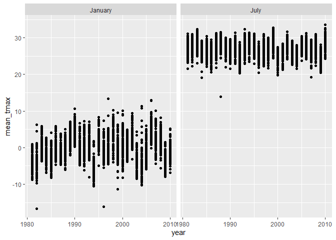
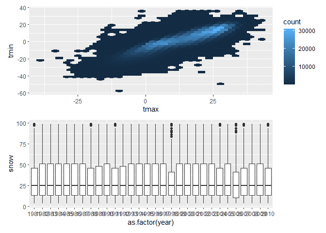
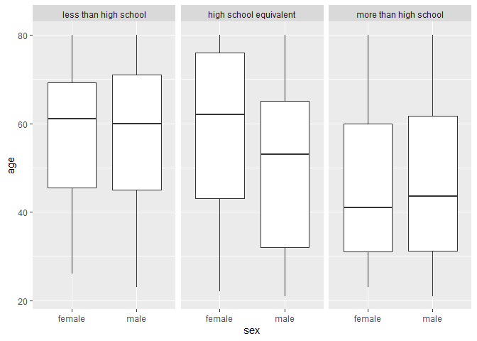

Homework 3
================
Meghan Brown (mmb2355)<br>
2026-10-19

## Problem 1

``` r
library(tidyverse)
```

    ## ── Attaching core tidyverse packages ──────────────────────── tidyverse 2.0.0 ──
    ## ✔ dplyr     1.2.1     ✔ readr     2.2.0
    ## ✔ forcats   1.0.1     ✔ stringr   1.6.0
    ## ✔ ggplot2   4.0.3     ✔ tibble    3.3.1
    ## ✔ lubridate 1.9.5     ✔ tidyr     1.3.2
    ## ✔ purrr     1.2.2     
    ## ── Conflicts ────────────────────────────────────────── tidyverse_conflicts() ──
    ## ✖ dplyr::filter() masks stats::filter()
    ## ✖ dplyr::lag()    masks stats::lag()
    ## ℹ Use the conflicted package (<http://conflicted.r-lib.org/>) to force all conflicts to become errors

``` r
library(p8105.datasets)
library(ggridges)
library(patchwork)

data("ny_noaa")
```

In the dataset ny_noaa, there are 2,595,176 rows and 7 columns. Key
variables are id, date, prcp, snow, snwd, tmax, and tmin. From the first
10 rows shown in the console, there are NA values for every variable
except for id and date. I believe that missing data is a great issue in
this dataset.

``` r
ny_noaa =
  ny_noaa |>
  janitor::clean_names() |> 
  drop_na() |> 
  mutate(
    year = year(date),
    month = month(date),
    day = day(date),
    tmax = as.numeric(tmax)/10,
    tmin = as.numeric(tmin)/10,
    prcp = as.numeric(prcp)/10
  )

ny_noaa |> 
  group_by(snow) |> 
  count(snow, sort = TRUE)
```

    ## # A tibble: 248 × 2
    ## # Groups:   snow [248]
    ##     snow       n
    ##    <int>   <int>
    ##  1     0 1112758
    ##  2    25   15809
    ##  3    13   12460
    ##  4    51    9252
    ##  5     5    5669
    ##  6     8    5380
    ##  7    76    5296
    ##  8     3    5276
    ##  9    38    5050
    ## 10   102    3386
    ## # ℹ 238 more rows

The most commonly observed snowfall is 0 mm, and that is because
snowfall is during the winter, and winter makes up about 1/4 of a year.

### Two-panel plot with average max temperature in January and in July in each station across years

``` r
ny_noaa |> 
  filter(month %in% c(1,7)) |> 
  group_by(id, year, month) |> 
    summarize(
    mean_tmax = mean(tmax, na.rm = TRUE), .groups = "drop"
  ) |>  
  mutate(
    month_name = case_match(
      month,
      1 ~ "January",
      7 ~ "July"
    )
  )|> 
  ggplot(aes(x = year, y = mean_tmax, color = id)) +
  geom_point() +
  facet_grid(. ~ month_name) +
  theme(legend.position = "none")
```

    ## Warning: There was 1 warning in `mutate()`.
    ## ℹ In argument: `month_name = case_match(month, 1 ~ "January", 7 ~ "July")`.
    ## Caused by warning:
    ## ! `case_match()` was deprecated in dplyr 1.2.0.
    ## ℹ Please use `recode_values()` instead.

<!-- -->

The average maximum temperatures are lower in January than in July,
across the years. This makes sense because January is one of the coldest
months in the year and July is one of the hottest. There are several
outliers in the January scatterplot (range: -17 C to 13 C) and fewer
outliers in the July one (\< 15 C).

### Two-panel plot showing (i) tmax vs tmin for the full dataset and (ii) the distribution of snowfall values greater than 0 and less than 100 separately by year

``` r
temp_diff = 
  ny_noaa |> 
  ggplot(aes(x = tmax, y = tmin)) +
  geom_hex() +
  theme(legend.position = "right")

snowfall_year = 
  ny_noaa |> 
  filter(snow > 0, snow < 100) |> 
  ggplot(aes(x = as.factor(year), y = snow)) +
  geom_boxplot() +
  theme(legend.position = "none")

(temp_diff/snowfall_year)
```

<!-- -->

## Problem 2

### Load, tidy, merge, and organize the data sets

``` r
accel_df =
  read_csv("nhanes_accel.csv", 
           na = c("NA","", ".")) |> 
  janitor::clean_names() |> 
  drop_na() |> 
  pivot_longer(
    min1:min1440,
    names_to = "min",
    names_prefix = "min",
    values_to = "acceleration"
  )
```

    ## Rows: 250 Columns: 1441
    ## ── Column specification ────────────────────────────────────────────────────────
    ## Delimiter: ","
    ## dbl (1441): SEQN, min1, min2, min3, min4, min5, min6, min7, min8, min9, min1...
    ## 
    ## ℹ Use `spec()` to retrieve the full column specification for this data.
    ## ℹ Specify the column types or set `show_col_types = FALSE` to quiet this message.

``` r
covar_df =
  read_csv("nhanes_covar.csv",
           na = c("NA","","."),
           skip = 4) |> 
  janitor::clean_names() |> 
  drop_na() |> 
  mutate(
    sex = case_match(
      sex,
      1 ~ "male",
      2 ~ "female"
    ),
    sex = factor(sex),
    education = case_match(
      education,
      1 ~ "less than high school",
      2 ~ "high school equivalent",
      3 ~ "more than high school"
    ),
  education = factor(
    education, levels = c("less than high school", "high school equivalent", "more than high school"))
  )
```

    ## Rows: 250 Columns: 5
    ## ── Column specification ────────────────────────────────────────────────────────
    ## Delimiter: ","
    ## dbl (5): SEQN, sex, age, BMI, education
    ## 
    ## ℹ Use `spec()` to retrieve the full column specification for this data.
    ## ℹ Specify the column types or set `show_col_types = FALSE` to quiet this message.

``` r
accel_final =
  left_join(covar_df, accel_df, by = "seqn") |> 
  filter(age >= 21)
```

### Number of men and women in each education category; visualization of the age distributions for men and women in each education category

``` r
accel_final |> 
  group_by(sex) |> 
  summarize(count = n()) |> 
  knitr::kable(digits = 2)
```

| sex    |  count |
|:-------|-------:|
| female | 158400 |
| male   | 169920 |

``` r
accel_final |> 
  ggplot(aes(x = sex, y = age)) +
  geom_boxplot() +
  facet_grid(. ~ education)
```

<!-- -->

- In the dataset, there is 158,400 women (females) and 169,920 men
  (males)
- In the boxplot, the median age between men and women who’s education
  level is less than high school are the most similar (around 60 years
  old), while the median for both sexes who’s education level is high
  school equivalent is the most different (62 years for women, 53 years
  for men). Women and men who’s education level is more than high school
  have the lowest median compared to the other education level groups,
  with ages 41 and 43, respectfully.
